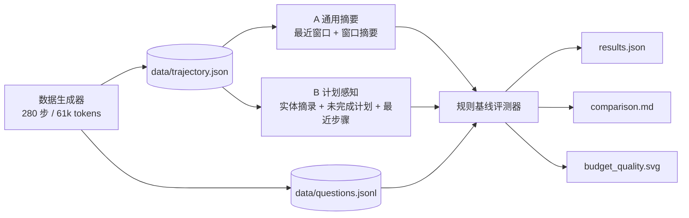

# 长程智能体上下文压缩：可验证压缩与计划感知策略

对应社区任务：[openJiuwen/community#42](https://atomgit.com/openJiuwen/community/issues/42)（20 分）

本项目实现一个**离线可复现**的长程上下文压缩与评测闭环：合成 280 步、约 61k tokens 的 Agent 轨迹，压缩到 2k / 4k / 8k 三档预算，并用 38 条可验证问答题检查压缩后是否仍保留订单号、文件路径、错误码、约束条件等事实。

## 结果摘要

| 方法 | 预算 | 实际 tokens | 压缩率 | 问答准确率 | 相比基线下降 | 门槛 |
|---|---:|---:|---:|---:|---:|:---:|
| A 通用摘要 | 2000 | 1991 | 96.7% | 2.6% | 97.4% | FAIL |
| A 通用摘要 | 4000 | 3982 | 93.5% | 2.6% | 97.4% | FAIL |
| A 通用摘要 | 8000 | 7964 | 87.0% | 2.6% | 97.4% | FAIL |
| **B 计划感知** | 2000 | 1957 | **96.8%** | **100%** | **0.0%** | **PASS** |
| **B 计划感知** | 4000 | 3948 | **93.6%** | **100%** | **0.0%** | **PASS** |
| **B 计划感知** | 8000 | 7938 | **87.0%** | **100%** | **0.0%** | **PASS** |

不压缩基线：61,252 tokens，问答准确率 100%。B 策略在全部三档均满足「token 降低 ≥40% 且准确率下降 ≤8pp」。

完整报告见 [`reports/comparison.md`](reports/comparison.md)，曲线见 [`reports/budget_quality.svg`](reports/budget_quality.svg)。

## 架构



压缩器与评测器完全分离：压缩器只能读取轨迹与预算，评测器持有问题与答案，二者不共享状态，避免「把答案写进 summary」的作弊路径。

## 快速开始

```bash
cd workshop/long-horizon-context
python -m pip install -e .

# 1. 生成确定性数据（固定 seed=2026）
agent-context generate --out data

# 2. 单档评测（对应任务要求的最小 CLI 形式）
agent-context eval --budget 4096 --method b --out reports

# 3. 全量对比 + 门槛检查
agent-context eval --budgets 2000,4000,8000 --methods a,b --out reports --fail-on-threshold

# 4. 测试
python -m pytest tests -q
```

未安装包时也可以用 `python -m agent_context.cli` 替代 `agent-context`。

## 目录结构

```text
long-horizon-context/
├── agent_context/
│   ├── generator.py          # 确定性轨迹与事实生成
│   ├── schema.py             # Step / Fact / RetainedSpan / CompressedBundle
│   ├── tokenizer.py          # 固定 cl100k_base，优先离线缓存
│   ├── compressors/
│   │   ├── base.py           # 片段模型、预算装配、审计统计
│   │   ├── generic.py        # 策略 A
│   │   └── plan_aware.py     # 策略 B
│   ├── evaluator.py          # 规则基线问答与门槛判定
│   ├── metrics.py            # Markdown 表格与 SVG 曲线
│   └── cli.py                # agent-context 命令
├── data/
│   ├── trajectory.json       # 280 步轨迹（含 38 个事实）
│   ├── questions.jsonl       # 38 条问答题（hold-out）
│   └── tokenizer/<sha1>      # 内置 cl100k_base 编码文件，离线加载
├── reports/                  # 评测输出
├── scripts/download_tokenizer.py
└── tests/
```

## 数据契约

### Step

| 字段 | 说明 |
|---|---|
| `step_id` | 0 起始的步骤编号 |
| `role` | `assistant` / `tool` |
| `content` | 步骤正文 |
| `tool_name` | 工具名，可为空 |
| `tool_result` | 工具返回，可为空 |
| `kind` | `plan` / `tool_call` / `observation` / `reflection` |
| `milestone_id` / `milestone_status` | 所属里程碑与状态（`done` / `pending`） |

### CompressedBundle

| 字段 | 说明 |
|---|---|
| `summary_text` | 压缩后的上下文，硬约束 `tokens <= budget_tokens` |
| `retained_spans` | 保留片段：`start_step`、`end_step`、`sha256`、`tokens`、`kind` |
| `dropped_stats` | 按 `kind` 统计丢弃的步数与字符数 |
| `token_count` / `budget_tokens` | 固定 tokenizer 计数 |

## 两种策略

- **A 通用摘要**：保留最近 20% 步骤原文，其余按 5 步窗口摘要，每步正文截断到 80 字符。它不识别实体，预算收紧时事实句会被截断。
- **B 计划感知**：先用正则识别订单号、文件路径、接口路径、错误码、表名、配置项、百分比、金额/时限、时间戳；对命中步骤只摘录包含实体的句子；再保留未完成里程碑的 `plan` 步骤与最近 8 步原文；剩余步骤做窗口摘要。

实体识别规则（`compressors/plan_aware.py`）：

```text
ORD-\d{4}-\d{5}
/data/[\w\-./]+
/api/v\d/[\w/{}\-]+
E\d{4}
(ods|dwd|dws|dim)_[a-z_0-9]+
(reconcile|refund|audit|stock)\.[a-z_]+=\S+
\d+(\.\d+)?%
\d+\s*(CNY|次|小时|天|笔|秒)
20\d{2}-\d{2}-\d{2}\s+\d{2}:\d{2}
```

## 评测方法

评测器是**规则基线**，不调用任何外部模型或网络：

1. 读取 `questions.jsonl` 中的问题与期望答案；
2. 在 `summary_text` 中做字面量检索；
3. 命中即正确，计算准确率；
4. 同时报告 `full_tokens`、`token_count`、`reduction`、`accuracy_drop`；
5. `reduction >= 40%`、`accuracy_drop <= 8pp`、`token_count <= budget` 三者同时成立才标记 PASS。

问题集由生成器单独产出，压缩器不读取，满足 hold-out 要求。

## 可复现性

- **固定 tokenizer**：`cl100k_base`，编码文件随仓库提供在 `data/tokenizer/`，`tokenizer.py` 通过 `TIKTOKEN_CACHE_DIR` 指向该目录，压缩与评测过程不联网。
- 若该文件缺失，可运行 `python scripts/download_tokenizer.py` 重新拉取（仅此步骤需要网络）。
- **固定随机种子**：`build_trajectory(seed=2026)`，轨迹与事实确定。
- **固定数据**：`data/trajectory.json` 与 `data/questions.jsonl` 已随仓库提交。
- **单次评测耗时**：本机三档 × 两种方法约 1 秒级，内存占用远低于 16GB。

## 审计性

每个 `RetainedSpan` 的 `sha256` 是来源步骤（或窗口原始拼接文本）的 SHA-256 前 8 位，可据此回到 `start_step` / `end_step` 校验原文；`dropped_stats` 记录被丢弃的步数与字符数，便于判断压缩代价。

## 复杂度

- 生成器：O(n) 步骤构造，n = 280。
- 策略 A / B：O(n) 扫描 + 片段排序 O(s log s)，s 为片段数；tokenizer 计数 O(文本长度)。
- 内存：轨迹与压缩结果均为线性，约几十 MB 量级。
- 预算装配：贪心选择片段，超预算时截断最后一段，并做一次整体 `truncate` 兜底，保证硬约束。

## 失败分析

策略 A 在三档预算下准确率都只有 2.6%：窗口摘要按 80 字符截断正文，而事实句位于每步正文末尾，导致订单号、路径、错误码几乎全部丢失；预算增加只是多保留最近步骤，无法覆盖轨迹前 80% 的事实。策略 B 通过实体摘录把每个事实压缩成一句短文本，38 个事实在 2k 预算内即可全部保留，因此三档均为 100%。

## 验收对照

| 任务要求 | 实现 |
|---|---|
| ≥200 步或 ≥50k tokens | 280 步 / 61,252 tokens |
| 压缩器接口与 bundle 字段 | `compressors/base.py`、`schema.py` |
| ≥20 条可验证问答 | 38 条，`data/questions.jsonl` |
| 两类策略对比 + 失败分析 | `reports/comparison.md` |
| 2k/4k/8k 预算曲线 | `reports/budget_quality.svg` |
| token 降 ≥40%、准确率降 ≤8pp | B 策略 87%–96.8% 压缩率、0pp 下降 |
| retained_spans 可审计 | SHA-256 前 8 位 + step 范围 |
| 压缩不联网 | 内置 tokenizer 编码文件 |
| 压缩器与评测器分离 | 独立模块，问题集不进入压缩器 |
| CLI | `agent-context eval --budget 4096 --method b` |

## License

与 openJiuwen community 仓一致，遵循仓库根目录的许可与版权规范。