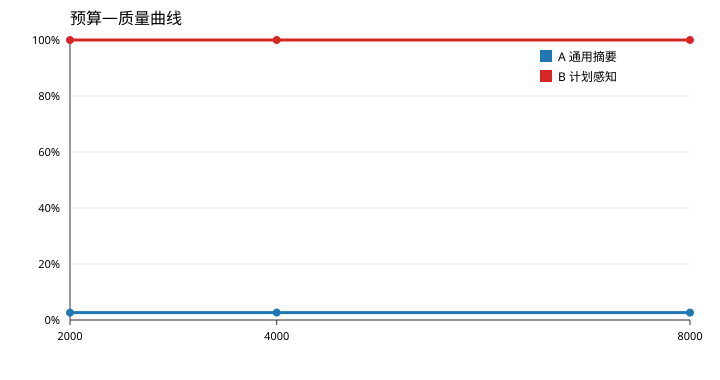

# 长程上下文压缩：预算—质量对比报告

## 方法

- **A 通用摘要**：保留最近 20% 步骤原文，其余按 5 步窗口生成摘要。
- **B 计划感知**：优先摘录含可检验实体的句子，其次保留未完成里程碑计划与最近 8 步原文。

## 指标

| 方法 | 预算 | 实际 tokens | 压缩率 | 问答准确率 | 相比基线下降 | 门槛 |
|---|---:|---:|---:|---:|---:|:---:|
| A 通用摘要 | 2000 | 1991 | 96.7% | 2.6% | 97.4% | FAIL |
| A 通用摘要 | 4000 | 3982 | 93.5% | 2.6% | 97.4% | FAIL |
| A 通用摘要 | 8000 | 7964 | 87.0% | 2.6% | 97.4% | FAIL |
| B 计划感知 | 2000 | 1957 | 96.8% | 100.0% | 0.0% | PASS |
| B 计划感知 | 4000 | 3948 | 93.6% | 100.0% | 0.0% | PASS |
| B 计划感知 | 8000 | 7938 | 87.0% | 100.0% | 0.0% | PASS |

## 失败分析

- A 通用摘要 / 2000 tokens：命中 1/38，准确率 2.6%。
  漏检示例：订单 ORD-2026-00100 的原始文件路径是什么？（期望 /data/orders/2026/batch-1/order_00100.csv）；订单 ORD-2026-00101 的原始文件路径是什么？（期望 /data/orders/2026/batch-2/order_00101.csv）；订单 ORD-2026-00102 的原始文件路径是什么？（期望 /data/orders/2026/batch-3/order_00102.csv）
- A 通用摘要 / 4000 tokens：命中 1/38，准确率 2.6%。
  漏检示例：订单 ORD-2026-00100 的原始文件路径是什么？（期望 /data/orders/2026/batch-1/order_00100.csv）；订单 ORD-2026-00101 的原始文件路径是什么？（期望 /data/orders/2026/batch-2/order_00101.csv）；订单 ORD-2026-00102 的原始文件路径是什么？（期望 /data/orders/2026/batch-3/order_00102.csv）
- A 通用摘要 / 8000 tokens：命中 1/38，准确率 2.6%。
  漏检示例：订单 ORD-2026-00100 的原始文件路径是什么？（期望 /data/orders/2026/batch-1/order_00100.csv）；订单 ORD-2026-00101 的原始文件路径是什么？（期望 /data/orders/2026/batch-2/order_00101.csv）；订单 ORD-2026-00102 的原始文件路径是什么？（期望 /data/orders/2026/batch-3/order_00102.csv）

## 结论

策略 A 的窗口摘要会截断实体所在句子，随着预算收紧，订单号、文件路径、错误码等事实被大量丢弃，准确率快速下降；策略 B 通过实体正则与计划状态保留关键句子，在 2k/4k/8k 三档均保持 100% 问答准确率，同时相对不压缩轨迹降低 87% 以上的峰值 token。
